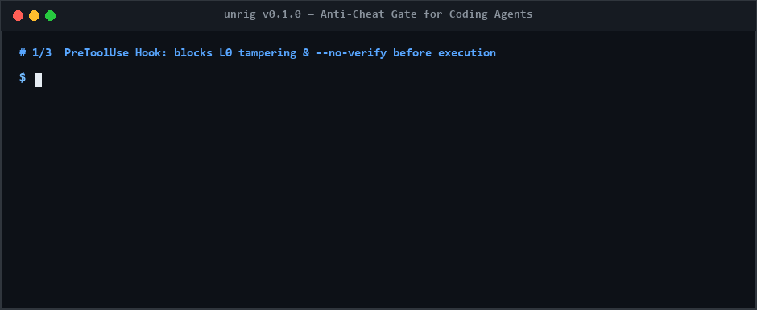

# Unrig

[](https://github.com/Janson79jc/unrig/actions/workflows/ci.yml)
[](https://pypi.org/project/unrig/)
[](https://www.npmjs.com/package/@janson79jc/unrig)
[](LICENSE)

**English** | [简体中文](README_zh.md)

**Anti-cheat for coding agents — deterministic pre-tool hooks, diff/JUnit freshness gates, and isolated blind review.**

> Stop coding agents from editing `.unrig.yaml`, sneaking in `assert True` / `@ts-ignore`, passing `--no-verify`, or submitting stale `junit.xml` reports (not affiliated with 3D rigging / `UniRig`).

**Unrig** locks the verification boundary cleanly — **100% offline / zero telemetry / zero third-party runtime dependencies (Python >= 3.10 stdlib only)** and **non-invasive on brownfield repos** (zero source-code marker annotations required).



**Try 10 built-in escape-replay scenarios locally in 5 seconds (zero setup):**

```bash
uvx unrig replay
# or via npm:
npx @janson79jc/unrig replay
```

---

## Architecture at a Glance

```text
  Agent Tool Call (Write / Edit / Bash)
                 │
                 ▼
  ┌─────────────────────────────┐   exit 2 / JSON deny (L0 writes, traversal, `> file`, `--no-verify`)
  │   1. `unrig hook` (L0 Guard)│────────────────────────────────────────────────► BLOCKED
  └──────────────┬──────────────┘
                 │ exit 0 / allow
                 ▼
  ┌─────────────────────────────┐
  │ 2. `unrig verify` Referee   │
  │   • L0 Integrity            │── git `-uall -z` + `HEAD:.unrig.yaml` union + CRLF-normalized SHA-256
  │   • Format Comment Blanker  │── 1:1 newline preservation (Py, JS/TS `/regex/`+`${}`, Vue, Java, Go, XML, SQL, SH, YAML)
  │   • `CounterMultiset` Diff  │── `(after - before)` stubs, `DUMMY-CONSTANT-RETURN`, `CLONE-SPAM`, `TYPE-ESCAPE`, suppressions, `.unrig/ratchet.json`
  │   • JUnit & Coverage Proof  │── `<testsuite>`/`<testsuites>`, freshness, `skipped == 0`, `skipped_ignored`/`syntax_fallback`/`SHALLOW_HISTORY`
  └──────────────┬──────────────┘
                 │ [PASS]
                 ▼
  ┌─────────────────────────────┐
  │ 3. Blind Auditor `[🛑]`      │   clean context, read-only diff review (no writer excuses leaked)
  └─────────────────────────────┘
```

---

## Why Unrig vs. Ordinary Linters / `pre-commit`?

| Failure Mode | Standard Linter / `pre-commit` | Unrig |
|---|---|---|
| Agent edits `.unrig.yaml` or `--no-verify` | Bypassed cleanly | Blocked pre-write (`unrig hook` exit `2`) + detected unstaged via `-uall -z` + `HEAD` union lock |
| Agent duplicates existing dirty debt in brownfield file | Ignored by line diffs or fails whole legacy file | Caught by `CounterMultiset(after - before)` without touching untouched legacy debt |
| Agent weakens/skips tests (`assert True`, `.only`, `skipped=1`, `@ts-ignore`) | Compiles & passes CI | Blocked by AST/lexical stub, focus, catch & suppression rules + `forbid_skipped: true` + method floors |
| Agent submits old green `junit.xml` after editing code | Passes file existence check | Blocked as `[REPORT_STALE]` (`xml_mtime < max_source_mtime - 1s`) |
| Agent fakes passing stubs (`return True`, copy-paste test clones) | Compiles & inflates green test counts | Blocked by `DUMMY-CONSTANT-RETURN` + incremental `CLONE-SPAM` (`Alpha-Normalized` diff clone check) |
| External runtime dependencies / cloud sync | Heavy install / cloud accounts | Zero third-party deps (Python stdlib only), 100% air-gapped, zero telemetry |

---

## Quickstart

```bash
# Install from PyPI (one-liner):
pip install unrig
# Or run zero-setup via uvx / npx / install isolated via pipx / npm:
# uvx unrig replay
# npx @janson79jc/unrig replay
# pipx install unrig
# npm install -g @janson79jc/unrig

# Or install from source:
# git clone https://github.com/Janson79jc/unrig.git && cd unrig && pip install -e .

# 1. Initialize `.unrig.yaml` and `.unrig/` protocol/auditor templates
#    (add `--client claude|antigravity|gemini|codex|all` to generate client hook configs automatically)
unrig init
git add .unrig.yaml .unrig/ && git commit -m "chore: initialize unrig Level 0 gates"

# Optional (recommended): tell your agent in `CLAUDE.md` / `AGENTS.md` / `GEMINI.md`:
# "Follow .unrig/PROTOCOL.md, run `unrig verify` before finishing, and review diffs with .unrig/blind_auditor_prompt.md."

# 2. Run verification referee
unrig verify

# 3. Check or tighten stale `.unrig/ratchet.json` caps as debt is paid down
unrig ratchet --check
unrig ratchet --prune

# 4. Inspect local interception ledger (recorded silently on blocks in `.unrig/.cache/events.jsonl`)
unrig stats --days 7

# 5. Verify Unrig's own referee against built-in escape mutations
unrig replay

# Optional: run the standalone escape-replay showcase
python examples/escape-replay/run_demo.py
```

---

## Wiring `unrig hook` (`PreToolUse` / `BeforeTool` / `Stop`)

`unrig hook` auto-detects the caller protocol from `stdin` JSON (or via `--client claude|antigravity|gemini|codex`):

- **Claude Code** (`.claude/settings.json` via `unrig init --client claude`): blocks `Write|Edit|MultiEdit|Bash` with exit code **`2`** and prints the reason to `stderr`.
- **Google Antigravity** (App, IDE, and `agy` CLI via `unrig init --client antigravity` -> `.agents/hooks.json`): matches `run_command|write_file|edit_file|write_to_file|replace_file_content|multi_replace_file_content|...`, responds on `stdout` with `{"decision": "allow"}` / `{"decision": "deny", "reason": "..."}` for `PreToolUse` (while allowing read-only tools), and gates `Stop` by running `unrig verify` (`{"decision": "continue", "reason": "..."}` up to 2 consecutive identical bounces, then releases cleanly for human escalation).
- **Google Gemini CLI** (`.gemini/settings.json` via `unrig init --client gemini`): responds on `stdout` with `{"decision": "allow"}` / `{"decision": "deny", "reason": "..."}` for `BeforeTool`.
- **OpenAI Codex CLI** (`.codex/hooks.json` via `unrig init --client codex`): hooks `PreToolUse` (`Bash` matcher) to `unrig hook --client codex`, blocking forbidden commands / redirects / `--no-verify` with exit code **`2`** + `stderr` (and pair with `"Follow .unrig/PROTOCOL.md and run unrig verify before finishing"` in `AGENTS.md` so `unrig verify` also catches any file-patching edits at handoff).

Example `.claude/settings.json` (`.codex/hooks.json` uses `"matcher": "Bash"` and `"command": "unrig hook --client codex"`):

```json
{
  "hooks": {
    "PreToolUse": [
      {
        "matcher": "Write|Edit|MultiEdit|Bash",
        "hooks": [
          {
            "type": "command",
            "command": "unrig hook --client claude"
          }
        ]
      }
    ]
  }
}
```

When any tool attempts to modify a path in `protected_l0_files` (including client hook configs `.claude/settings.json`, `.agents/hooks.json`, `.gemini/settings.json`, and `.codex/hooks.json`), even via `../` traversal, Windows backslashes, shell output redirections like `> .unrig.yaml`, or `git ... commit/push --no-verify`, `unrig hook` blocks it deterministically.

> **Defense-in-Depth Boundary**: `unrig hook` is the fast pre-execution guardrail against accidental edits and common bypasses at the agent tool layer; `unrig verify` (backed by git working-tree status, `HEAD:.unrig.yaml` union locks, and CRLF-normalized hashes) is the deterministic backstop before acceptance or CI merge.

---

## `.unrig.yaml` Reference

| Key | Default | Purpose |
|---|---|---|
| `version` | `1` | Schema version |
| `protected_l0_files` | `[.unrig.yaml, .unrig/ratchet.json, .unrig/PROTOCOL.md, .unrig/blind_auditor_prompt.md, .claude/settings.json, .agents/hooks.json, .gemini/settings.json, .codex/hooks.json]` | Extra paths always merged with immutable L0 defaults + `HEAD:.unrig.yaml` |
| `reports.require_reports` | `false` | Fail with `[REPORT_MISSING]` if no JUnit XML matches `junit_globs` |
| `reports.forbid_skipped` | `true` | Fail if `skipped > 0` in any JUnit XML |
| `reports.junit_globs` | Surefire / `junit*.xml` / `test-results/*.xml` | Glob patterns for JUnit XML discovery |
| `reports.required_tests` | `{}` | Map of `suite_name: [method_a, ...]` that must execute non-skipped |
| `reports.require_fresh_against` | `[]` | Custom source globs for staleness timestamp check (defaults to all non-ignored source files) |
| `reports.privilege_log_tokens` | `["--no-verify", "gate.mode=maintenance"]` | Tokens forbidden inside test XML logs / `.txt` outputs |
| `runtime_proof_artifacts` | `[]` | List of `{path, max_age_seconds}` runtime artifacts verified fresh & non-empty |
| `diff_checks.enabled` | `true` | Toggle `CounterMultiset(after - before)` incremental scan |
| `diff_checks.baseline` | `"HEAD~1"` | Git revision baseline (`HEAD` fallback on single-commit repos; emits `[WARN] [SHALLOW_HISTORY]` on shallow clones) |
| `diff_checks.forbidden_patterns` | `[]` | Team-specific `{id, pattern, message, paths}` rules matched against comment-blanked code |
| `diff_checks.clone_warn_threshold` | `2` | Net-new cross-file `Alpha-Normalized` isomorphic blocks before emitting `[WARN] [CLONE-SPAM]` |
| `diff_checks.clone_block_threshold` | `3` | Net-new cross-file `Alpha-Normalized` isomorphic blocks before blocking with `[FAIL] [CLONE-SPAM]` |
| `diff_checks.clone_min_tokens` | `15` | Minimum normalized token count for a block to participate in incremental clone detection |
| `ratchet_file` | `".unrig/ratchet.json"` | JSON ledger requiring non-empty `reason` (>= 3 chars) per grandfathered cap |
| `shell_write_redirect_guards` | `true` | Inspect shell tool commands in `unrig hook` for L0 redirects / `--no-verify` |

---

## Air-Gapped & Privacy Guarantee

`unrig` makes **zero network calls** and contains **zero telemetry**. All configuration, ratchet ledgers, and verification runs stay strictly local on your machine.

---

## Contributing, Agents & Security

- **Contributors & AI Policy**: Read [CONTRIBUTING.md](CONTRIBUTING.md) (human accountability + required PR AI disclosure aligned with modern open-source standards).
- **Testing Guide & Rigor Standards**: Read [TESTING.md](TESTING.md).
- **Coding Agents Working on This Repo**: Read [AGENTS.md](AGENTS.md).
- **Security & Escape Bypass Reports**: Read [SECURITY.md](SECURITY.md).
- **Community Standards**: Read [CODE_OF_CONDUCT.md](CODE_OF_CONDUCT.md).
- **License**: [Apache-2.0](LICENSE) — see [CHANGELOG.md](CHANGELOG.md) for release notes.
